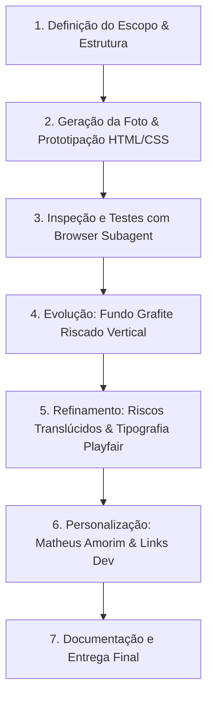

# 🚀 Documentação Técnica — Perfil Profissional Matheus Amorim

Guia completo sobre a arquitetura, tecnologias, processo de desenvolvimento e ferramentas utilizadas na criação da página de perfil profissional minimalista e sofisticada (estilo *Link-in-Bio* / *Linktree*).

---

## 🛠️ Desenvolvido com Google Antigravity IDE

Este projeto foi totalmente concebido, prototipado, estilizado e validado através do **Google Antigravity IDE**, o ambiente de desenvolvimento integrado AI-first desenvolvido pela equipe da Google DeepMind.

- **Plataforma**: [Google Antigravity IDE](https://antigravity.google)
- **Versão da Plataforma**: **Antigravity 2.0 / Antigravity IDE**
- **Motor de Inteligência**: Gemini 3.8 Flash (Advanced Agentic Coding)
- **Documentação Oficial**: [https://antigravity.google/docs](https://antigravity.google/docs)

### Capacidades Agentic Utilizadas no Desenvolvimento:
1. **Geração Autônoma de Código**: Criação modular de arquivos HTML5 semânticos, CSS moderno e scripts JavaScript puros.
2. **Geração de Imagens com IA (`generate_image`)**: Criação direta de retratos profissionais em alta resolução com especificações fotográficas de iluminação de estúdio e paleta de cores grafite.
3. **Inspeção Visual Automatizada no Navegador (`browser_subagent`)**: Teste de ponta a ponta em navegador headless com captura de screenshots, validação de contrastes, responsividade mobile e testes de interação com botões e toasts.
4. **Gerenciamento de Processos em Segundo Plano (`run_command`)**: Inicialização e monitoramento de servidor local de desenvolvimento HTTP.

---

## 💻 Stacks e Tecnologias Utilizadas

A aplicação adota a filosofia de **zero dependências externas pesadas**, garantindo velocidade instantânea de carregamento, facilidade de manutenção e máxima performance:

| Camada | Tecnologia | Descrição & Uso |
| :--- | :--- | :--- |
| **Estrutura** | **HTML5 Semântico** | Marcação acessível utilizando tags `<main>`, `<header>`, `<section>`, `<footer>`, `<nav>`, atributos ARIA e metadados SEO/Open Graph completos. |
| **Estilização** | **Vanilla CSS3 Moderno** | Design System construído com variáveis CSS (`:root`), Flexbox, animações por curvas cúbicas de Bézier e gradientes matemáticos complexos. |
| **Lógica / Interações** | **JavaScript (ES6+)** | Manipulação do DOM, integração com `navigator.share`, fallback para API da Área de Transferência (`navigator.clipboard`) e sistema de notificações *toast*. |
| **Tipografia** | **Google Fonts** | Combinação editorial sofisticada: **Playfair Display** (serifada de luxo para o título) e **Plus Jakarta Sans** (geométrica contemporânea para corpo e botões). |
| **Ícones** | **SVG Vetorial Puro** | Ícones inline otimizados para máxima fidelidade e zero impacto no tempo de carregamento (Instagram, GitHub, LinkedIn, YouTube e Share). |
| **Servidor Local** | **Python 3 `http.server`** | Servidor HTTP leve para testes locais e validação em tempo real na porta `8085`. |

---

## 🎨 Design System e Detalhes Visuais

O design foi estruturado para transmitir alto padrão técnico, sobriedade e sofisticação (*dark luxury* / minimalismo arquitetônico):

### 1. Fundo Grafite com Riscos Verticais Translúcidos
O fundo foi construído sem imagens externas pesadas, usando puramente CSS com múltiplos gradientes sobrepostos:
- **Cor base**: Grafite escuro suave (`#1C1D20`).
- **Riscos verticais (*pinstripes*)**: `repeating-linear-gradient` com opacidade reduzida a `0.015` (`rgba(255, 255, 255, 0.015)`), criando um efeito tátil e suave, semelhante a metal escovado ou tecido risca-de-giz premium.
- **Baixo contraste tonal**: Variações sutis contíguas entre `#191a1d`, `#1b1c1f`, `#1d1e21` e `#1e1f22`.
- **Iluminação ambiente (*Spotlight*)**: `radial-gradient` no terço superior para destacar o cabeçalho e dar profundidade tridimensional à página.

### 2. Botões CTA de Alto Contraste
- Superfície branca pura (`#FFFFFF`) com borda suave (`#E5E7EB`).
- Tipografia semi-bold (`#18191C`) com *letter-spacing* refinado.
- Transições de hover suaves (`translateY(-2px)`) com elevação de sombras de profundidade.

### 3. Redes Sociais em Vidro Fosco (*Frosted Glass*)
- Botões circulares de 52px com fundo translúcido (`rgba(255, 255, 255, 0.05)`).
- Efeito de desfoque de fundo (`backdrop-filter: blur(8px)`).
- Inversão elegante no hover para branco puro com ícone escuro.

---

## 📋 Passo a Passo da Construção do Projeto



### Passo 1: Definição dos Requisitos Iniciais
- Criação da estrutura de uma única coluna centralizada vertical e horizontalmente.
- Planejamento de seções: Cabeçalho com foto circular, 4 botões CTA empilhados e 4 ícones sociais.

### Passo 2: Geração de Ativos e Prototipagem
- Geração da imagem de perfil de alta resolução usando ferramentas de síntese visual da IA.
- Escrita de [index.html](file:///c:/Users/mathe/Documents/linktree%20matheus%20portfolio/index.html) e [style.css](file:///c:/Users/mathe/Documents/linktree%20matheus%20portfolio/style.css).
- Criação do script de interações [script.js](file:///c:/Users/mathe/Documents/linktree%20matheus%20portfolio/script.js).

### Passo 3: Inicialização do Servidor & Auditoria Visual
- Inicialização do servidor HTTP local via terminal: `python -m http.server 8085`.
- Execução do agente de navegador (`browser_subagent`) para validação em múltiplos viewports (Desktop 1536x776 e Mobile 375x667).

### Passo 4: Transição para o Tema Grafite Escuro
- Substituição do fundo claro por um tema grafite sofisticado com riscas verticais estruturadas.
- Ajuste do contraste de textos, contornos dos cartões e sombras de profundidade.

### Passo 5: Refinamento de Contraste e Tipografia
- Ajuste das riscas para ficarem mais translúcidas e de baixíssimo contraste, eliminando cortes visuais duros.
- Introdução da tipografia serifada editorial de luxo **Playfair Display** no título e **Plus Jakarta Sans** no corpo.
- Tradução integral de todos os textos, descrições e botões para o português.

### Passo 6: Customização de Identidade — Matheus Amorim
- Atualização do nome para **Matheus Amorim**.
- Inclusão da nova proposta de valor:
  > *"Desenvolvimento web & mobile que impulsiona sua evolução digital. Código inteligente, design funcional, resultados reais."*
- Enquadramento em close-up (*headshot*) da fotografia de perfil.
- Atualização dos botões:
  - **"Visite Meu Site"**
  - **"Faça Seu Orçamento"**
- Substituição do ícone do Twitter pelo ícone do **GitHub**, apontando para `https://github.com/matheus2k221`.

---

## 📂 Estrutura de Arquivos do Projeto

```text
linktree matheus portfolio/
│
├── index.html                   # Estrutura HTML5 semântica e acessível
├── style.css                    # Design System completo e responsivo (Vanilla CSS)
├── script.js                    # Lógica de compartilhamento, clipboard e toasts
├── README.md                    # Guia rápido do repositório
├── DOCUMENTACAO.md              # Documentação técnica aprofundada (este documento)
│
└── assets/
    └── images/
        ├── profile.jpg          # Foto profissional de Matheus Amorim
        └── alex_profile.jpg     # Foto original preservada
```

---

## 🚀 Como Executar o Projeto Localmente

### Opção 1: Servidor Python Embutido (Recomendado)
Abra o terminal na pasta do projeto e execute:
```bash
python -m http.server 8085
```
Em seguida, acesse no navegador: **`http://localhost:8085`**

### Opção 2: Extensão Live Server (VS Code / Antigravity IDE)
Clique com o botão direito sobre o arquivo `index.html` e selecione **"Open with Live Server"**.

### Opção 3: Abertura Direta
Dê um duplo clique no arquivo `index.html` para abri-lo diretamente em qualquer navegador moderno.

---

## 🌐 Publicar no GitHub Pages e adicionar à bio do Instagram

O repositório já é público e pode ser hospedado gratuitamente pelo GitHub Pages. Como `index.html`, `style.css`, `script.js` e `assets/` estão na raiz, não é necessário configurar build ou instalar dependências.

### 1. Colocar a página no ar gratuitamente

1. Entre na conta GitHub que administra este repositório.
2. Abra [Settings > Pages](https://github.com/matheus2k221/template-de-link-in-bio-para-o-instagram/settings/pages).
3. Em **Build and deployment**, defina **Source** como **Deploy from a branch**.
4. Em **Branch**, escolha `main` e a pasta `/(root)`; clique em **Save**.
5. Aguarde a publicação. O GitHub exibirá o endereço da página nessa tela. Para este repositório, o endereço esperado é:

  `https://matheus2k221.github.io/template-de-link-in-bio-para-o-instagram/`

6. Abra o endereço no celular e no computador. Confira se a foto, o estilo e os ícones carregam corretamente.

Se a publicação não aparecer, confira a aba **Actions** do repositório e veja se a execução do GitHub Pages terminou sem erros. Cada atualização enviada à branch `main` gera uma nova publicação automaticamente; pode levar alguns minutos para ficar visível.

### 2. Definir o destino de cada botão

Antes de divulgar a página, abra `index.html` e substitua os valores de `href` nos elementos indicados. Os `href` que começam com `#` são exemplos: não levam a uma página externa.

| Botão atual | Destino recomendado | Sugestão de conteúdo |
| --- | --- | --- |
| **Visite Meu Site** (`btn-website`) | Seu portfólio ou site profissional. | Projetos recentes, serviços, resultados e uma forma de contato. Se ainda não tiver site, use seu perfil de projetos no GitHub. |
| **Minha Loja Online** (`btn-shop-store`) | Loja ou catálogo que esteja ativo. | Produtos ou serviços, preços, formas de pagamento, entrega e política de troca. Se não tiver loja, renomeie o botão para **Conheça meus projetos** e direcione para trabalhos reais. |
| **Faça Seu Orçamento** (`btn-quote`) | WhatsApp Business ou formulário de contato. | Peça à pessoa que informe o serviço desejado, prazo e detalhes do projeto. |
| **Materiais Gratuitos** (`btn-free-resources`) | Página pública com arquivos ou recursos. | E-book, checklist, modelo, guia ou aula gratuita. Confirme que o acesso está liberado para qualquer pessoa com o link. |

Exemplo de endereço para WhatsApp:

```text
https://wa.me/55DDDNUMERO?text=Ol%C3%A1%2C%20quero%20um%20or%C3%A7amento%20para%20um%20site.
```

Troque `55DDDNUMERO` por `55` + DDD + número, usando apenas dígitos. A mensagem após `text=` está codificada para URL. Não publique o botão sem substituir o número pelo seu.

Atualize também os links dos ícones sociais no mesmo `index.html`:

| Ícone | Link a configurar |
| --- | --- |
| Instagram (`social-instagram`) | `https://www.instagram.com/seuusuario/` |
| GitHub (`social-github`) | Seu perfil ou repositório mais relevante. |
| LinkedIn (`social-linkedin`) | `https://www.linkedin.com/in/seuusuario/` |
| YouTube (`social-youtube`) | `https://www.youtube.com/@seucanal` |

Troque os exemplos pelos seus perfis reais. Se uma rede não for usada, remova o ícone correspondente em vez de deixar um link genérico.

### 3. Adicionar o endereço à bio do Instagram

1. Copie o endereço publicado no GitHub Pages.
2. No Instagram, abra seu perfil e toque em **Editar perfil**.
3. Entre em **Links** e escolha **Adicionar link externo**.
4. Cole o endereço do GitHub Pages. Como título, você pode usar **Portfólio | Matheus Amorim**.
5. Salve, volte ao perfil e toque no link para confirmar que abre a página.

Sugestão de texto para a bio:

> Desenvolvimento Web & Mobile<br>
> Sites e experiências digitais sob medida<br>
> Portfólio e orçamento no link abaixo ↓

O nome de algumas opções pode variar conforme a versão do Instagram. Se o perfil já tiver outros links, deixe o portfólio em uma posição fácil de encontrar.

### 4. Publicar alterações nos links

Depois de editar e testar os `href` no `index.html`, envie as alterações para a branch `main`. O GitHub Pages atualizará o site; aguarde alguns minutos e teste novamente os botões na página pública.

---

## ⚙️ Guia de Customização Rápida

### Como Alterar os Links dos Botões
No arquivo [index.html](file:///c:/Users/mathe/Documents/linktree%20matheus%20portfolio/index.html), altere o atributo `href` de cada botão para a URL real desejada:
```html
<!-- Exemplo para o botão de orçamento (WhatsApp ou formulário) -->
<a href="https://wa.me/55SEUNUMERO" target="_blank" rel="noopener noreferrer" class="link-card">
  <span class="link-card-text">Faça Seu Orçamento</span>
</a>
```

### Como Trocar a Foto de Perfil
Substitua o arquivo `assets/images/profile.jpg` pela sua foto pessoal (recomenda-se formato quadrado 1:1, preferencialmente 600x600px ou superior).

### Como Ajustar as Cores do Tema
No arquivo [style.css](file:///c:/Users/mathe/Documents/linktree%20matheus%20portfolio/style.css), altere os valores declarados no bloco `:root`:
```css
:root {
  --color-bg-base: #1C1D20;        /* Cor do fundo grafite */
  --color-surface: #FFFFFF;        /* Cor dos botões CTA */
  --color-text-card: #18191C;      /* Cor do texto dos botões */
  /* ... */
}
```

---

## 📄 Licença e Créditos

- **Desenvolvedor**: Matheus Amorim
- **Ambiente de Desenvolvimento**: [Google Antigravity IDE](https://antigravity.google)
- **Ano**: 2026
- **Licença**: MIT (Livre para uso pessoal e comercial).
